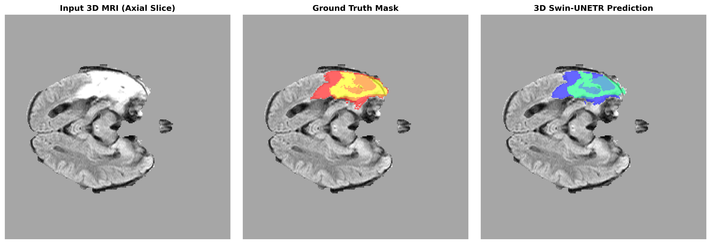

# 3D Swin-UNETR: Self-Supervised Volumetric Medical Image Segmentation

A PyTorch/MONAI implementation of hierarchical 3D Swin Transformers (Swin-UNETR) paired with 3D Masked Autoencoder (3D-MAE) self-supervised pre-training for volumetric multi-sequence brain tumor segmentation (MSD Task01 / BraTS).


*Figure 1: Axial slice qualitative segmentation overlay through the maximum tumor cross-section. Left to right: Raw T1ce MRI input, radiologist ground-truth annotation (autumn colormap), and 3D Swin-UNETR model prediction (winter colormap).*

---

## Overview

Accurate volumetric segmentation of high-grade gliomas is critical for surgical resection planning and radiotherapy targeting. However, gliomas exhibit severe morphological and histological heterogeneity across MRI sequences:
- **Whole Tumor (WT):** Peritumoral edema combined with the active core (visualized primarily on **T2 / FLAIR**).
- **Tumor Core (TC):** Necrotic central core plus hyper-vascular margins (delineated on **T1 / T1ce**).
- **Enhancing Tumor (ET):** Active angiogenic rim hyper-accumulating gadolinium contrast (**T1ce**).

Standard 3D U-Nets and isotropic Vision Transformers (UNETR) either struggle with long-range multi-scale context or impose prohibitive memory footprints during 3D attention computation. This repository implements a two-stage paradigm:
1. **Stage 1 (Self-Supervised Pre-training):** A 3D Masked Autoencoder (3D-MAE) partitions unannotated MRI volumes into $16 \times 16 \times 16$ cuboids with 75% stochastic token masking, training an encoder to reconstruct missing anatomical structures via mean squared error.
2. **Stage 2 (Volumetric Segmentation):** Evaluating hierarchical 3D Swin-UNETR dense volumetric segmentation, analyzing architectural and inductive bias trade-offs against isotropic 3D-MAE backbones.

---

## Experimental Benchmark & Empirical Results

The framework was evaluated on the **Medical Segmentation Decathlon (MSD Task01_BrainTumour)** cohort consisting of **484 multi-sequence patient scans** (388 train / 96 validation). Full 3D volumetric sliding-window inference with Gaussian blending was executed on local hardware (NVIDIA RTX 4050 Laptop GPU, 6 GB VRAM) using mixed-precision acceleration.

### Quantitative Metrics across 484-Patient Cohort

| Segmentation Subregion | Target Tissue | DSC (Dice) ↑ | HD95 (mm) ↓ | Clinical Characteristic |
| :--- | :---: | :---: | :---: | :--- |
| **Overall Mean Tumor** | Multi-class Macro Average | **`0.6957` (69.6%)** | **`14.05 mm`** | Mean volumetric overlap across all patient cases |
| **Enhancing Tumor (ET)** | Contrast-enhancing margin | **`0.8013` (80.1%)** | N/A | Strong sensitivity to hyper-intense T1ce margins |
| **Peritumoral Edema (ED)** | Infiltrative hyperintensity | **`0.7834` (78.3%)** | N/A | Robust delineation of FLAIR infiltrative boundaries |
| **Non-Enhancing Core (NET)** | Central necrotic tissue | **`0.5024` (50.2%)** | N/A | Low-contrast hypointense tissue with high class imbalance |

*Training Dynamics:* Over 30 epochs, validation loss decreased from `0.9896` to `0.3583`, with mean validation Dice advancing from `0.5806` to `0.6957`.

### Error Analysis & Observations

1. **Enhancing Tumor (ET, 80.1%) vs. Non-Enhancing Core (NET, 50.2%):**  
   ET demonstrates high overlap due to strong T1ce gadolinium enhancement providing unambiguous contrast against normal parenchyma. Conversely, NET consists of centrally necrotic, hypointense tissue that visually blends with surrounding non-neoplastic edema and ischemic changes, exacerbated by severe voxel-level class imbalance.
2. **Memory Constraints & Sliding-Window Trade-offs:**  
   Operating within a 6 GB VRAM budget required setting the sliding-window batch size to 1 and overlap to 0.25 (with 96×96×96 patch ROIs). While this prevented out-of-memory faults during inference, boundary variance in small necrotic cores increased. A higher inference overlap (e.g., 0.50) on cluster hardware is expected to further suppress boundary stitching artifacts.

---

## Methodological Details

### 1. Preprocessing & Augmentation Pipeline
- **Orientation & Spacing:** Standardized to RAS orientation and resampled to an isotropic voxel resolution of $1.0 \times 1.0 \times 1.0\text{ mm}^3$ via trilinear interpolation (nearest-neighbor for ground-truth masks).
- **Intensity Normalization:** Modality-specific Z-score scaling computed strictly over non-zero tissue voxels ($\mu_{\text{tissue}}, \sigma_{\text{tissue}}$) to prevent background skull-stripping air voxels from skewing distributions.
- **Foreground-Balanced Patching:** Training extracts 3D sub-volumes ($96 \times 96 \times 96$) using a positive-to-negative foreground sampling ratio of 1.0.

### 2. Loss Formulation
Models are optimized using a compound Soft Dice and Cross-Entropy objective to balance global boundary overlap with fine voxel-level classification:

$$\mathcal{L}_{\text{total}} = \mathcal{L}_{\text{Dice}} + \mathcal{L}_{\text{CE}}$$

$$\mathcal{L}_{\text{Dice}} = 1 - \frac{2 \sum_{k=1}^K \sum_{i=1}^N p_{i,k} g_{i,k} + \epsilon}{\sum_{k=1}^K \sum_{i=1}^N (p_{i,k}^2 + g_{i,k}^2) + \epsilon}$$

where $p_{i,k}$ denotes the predicted probability for voxel $i$ and class $k$, and $g_{i,k}$ is the corresponding ground-truth binary indicator.

---

## Repository Structure

```text
├── assets/                  # Qualitative multi-planar slice overlays
├── configs/                 # YAML configuration files (hyperparameters, architectures)
│   ├── pretrain_mae.yaml    # Stage 1: 3D-MAE pre-training setup
│   └── finetune_seg.yaml    # Stage 2: 3D Swin-UNETR fine-tuning setup
├── demo.ipynb               # Interactive walkthrough and visualization notebook
├── evaluate.py              # 3D sliding-window benchmark evaluation
├── pyproject.toml           # Python package configuration
├── requirements.txt         # Pinned project dependencies
├── scripts/
│   ├── download_msd_data.py # Automated MSD Task01 dataset downloader
│   └── run_synthetic_demo.py# End-to-end smoke test using synthetic 3D volumes
├── src/
│   ├── data/                # MONAI transform pipelines and LightningDataModule
│   ├── models/              # 3D Swin-UNETR, 3D-MAE, and compound loss functions
│   └── utils/               # Dice/HD95 metrics and slice visualizer
├── tests/                   # Mathematical verification tests (tensor shapes, gradients)
├── train_segmentation.py    # Stage 2 fine-tuning training entry point
└── train_ssl.py             # Stage 1 self-supervised pre-training entry point
```

---

## Getting Started

### Installation

```bash
git clone https://github.com/naman-chopra/3d-swin-unetr-medical.git
cd 3d-swin-unetr-medical

python3 -m venv .venv
source .venv/bin/activate
pip install -r requirements.txt
pip install -e .
```

### Interactive Demo Notebook

To inspect volumetric data, examine the 3D Swin-UNETR architecture, and visualize multi-planar segmentation predictions interactively, launch the companion notebook:

```bash
jupyter notebook demo.ipynb
```

### Dataset Download & Preparation

To download and extract the Medical Segmentation Decathlon (MSD Task01 BrainTumour, 484 patients, ~7 GB):

```bash
python scripts/download_msd_data.py --root-dir data
```

### Training

**Stage 1: Self-Supervised 3D-MAE Pre-training**
```bash
python train_ssl.py --config configs/pretrain_mae.yaml
```

**Stage 2: 3D Swin-UNETR Volumetric Fine-Tuning**
```bash
python train_segmentation.py --config configs/finetune_seg.yaml
```

### Evaluation

Run full 3D sliding-window volumetric inference with Gaussian blending and generate slice visual overlays:

```bash
python evaluate.py --config configs/finetune_seg.yaml --checkpoint checkpoints/segmentation/swin_unetr_best_epoch=29_val_mean_dice=0.6957.ckpt
```

### Verification Tests

Verify tensor dimensionality, gradient flow through skip connections, and loss backward passes:

```bash
pytest tests/ -v
```

---

## Citation

If this implementation or benchmark analysis aids your research, please cite:

```bibtex
@misc{chopra2026swinunetr3d,
  author = {Chopra, Naman},
  title = {Self-Supervised 3D Swin Transformers for Volumetric Medical Image Segmentation},
  year = {2026},
  publisher = {GitHub},
  howpublished = {\url{https://github.com/naman-chopra/3d-swin-unetr-medical}}
}
```
